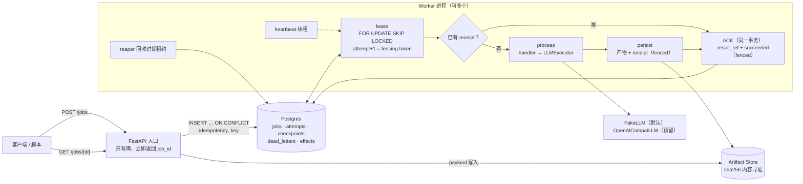

# personal-agent

一个以**异步任务队列**为核心的个人助理型 Agent。当前是 **M0：可靠的单队列骨架**。

- 提交与执行分离：`POST /jobs` 只写库并返回 `job_id`，Worker 在后台消费。
- Postgres 同时充当 Broker 和 State Store：`FOR UPDATE SKIP LOCKED` 领任务，用租约加心跳占用执行权，过期租约自动回收。
- **先持久化，再 ACK**：结果产物写入内容寻址存储并记录 durable receipt；ACK 在一个事务里同时写结果和改状态。
- **至少一次投递 + 幂等**：`idempotency_key` 去重；Worker 执行前先查回执，崩溃恢复时不会重复调用模型。
- **fencing token**：`attempt` 每次 lease 加 1，过期租约持有者的所有写入都会被拒绝。
- 默认使用确定性的 fake LLM，不需要 API key；预留了 OpenAI 兼容接口（`PA_LLM=openai`）。

设计文档见 [docs/design.md](docs/design.md)，M0 验收报告见 [docs/m0-test-report.md](docs/m0-test-report.md)。

## 架构



任务状态（M0）：`queued → leased → succeeded`；失败时 `leased → retry_wait →（退避到期）→ leased`；超过重试上限或遇到不可重试错误时进入 `dead`，并写一条 `dead_letters` 记录；租约过期后回到 `queued`。

| 崩溃位置 | 恢复行为 |
|---|---|
| 持久化之前 | 没有回执；租约过期后重新投递，重新执行一次 |
| 持久化之后、ACK 之前 | 回执已落盘；新 worker 直接用回执 ACK，**不再调用模型** |
| 旧持有者恢复后继续写 | fencing 条件不满足，写入影响 0 行，抛 `LeaseLost` 后放弃 |

## 目录

```text
personal_agent/
  core/        storage.py（内容寻址存储，改编自 security-agent）· executor.py（LLM 执行端口）
               context.py（JobContext：complete / step 检查点 / effect 副作用账本）· errors.py
  queue/       broker.py（Postgres 队列）· worker.py（主循环）· faults.py（测试用故障注入）
  api/         app.py（POST /jobs、GET /jobs/{id}、/healthz）
  infra/       fake_llm.py · openai_compat.py · llm.py（按 PA_LLM 选择）
  tasks/       demo.py（demo.summarize）
migrations/    0001_init.sql
tests/         test_acceptance.py（6 条验收）· test_unit.py
scripts/       run-local.sh · stop-local.sh · render_test_report.py
```

## 本地运行

需要 Python 3.12+ 和 PostgreSQL（推荐 17）。

```bash
# 1) 起 Postgres（二选一）
docker compose up -d                       # 用 docker-compose.yml，会同时创建 personal_agent_test 测试库
# 或者用本机已经安装的 Postgres：创建用户 personal_agent，以及 personal_agent、personal_agent_test 两个库

# 2) 配置
cp .env.example .env                       # 修改 DATABASE_URL / TEST_DATABASE_URL；.env 不会被提交

# 3) 安装
python3.12 -m venv .venv && .venv/bin/pip install -e '.[dev]'   # 或者 uv venv -p 3.12 && uv pip install -e '.[dev]'

# 4) 迁移（两种方式都可以）
.venv/bin/python -m personal_agent migrate
# psql "$DATABASE_URL" -f migrations/0001_init.sql

# 5) 启动 API 和 worker（后台运行，日志在 var/log/）
./scripts/run-local.sh                     # API 在 127.0.0.1:8080
# 前台运行：
# .venv/bin/python -m personal_agent api --port 8080
# .venv/bin/python -m personal_agent worker --concurrency 4 --lease-seconds 30

# 6) 试一下
curl -s -XPOST localhost:8080/jobs -H 'content-type: application/json' \
  -d '{"task_type":"demo.summarize","payload":{"text":"第一句。第二句。第三句。第四句。"},"idempotency_key":"demo-1"}'
curl -s "localhost:8080/jobs/<job_id>?include_result=true"

./scripts/stop-local.sh                    # 优雅停止
```

注意：已经导出到 shell 的环境变量优先于 `.env`。worker 启动日志里的 `worker_start` 事件会打印实际连接的库名（不含密码），启动后可以用它确认没有连错库。

接真实模型：设置 `PA_LLM=openai`、`PA_LLM_BASE_URL`、`PA_LLM_API_KEY`、`PA_LLM_MODEL`（任意 OpenAI 兼容的 `/chat/completions`）。密钥只从环境变量读取。M0 的测试只用 fake LLM。

## 接入真实模型（OpenCode）

默认 `PA_LLM=fake`，不会调用任何真实模型。可选两条路径：

| 方式 | 配置 | 能用的模型 | 是否需要 key |
|---|---|---|---|
| OpenCode CLI | `PA_LLM=opencode`，可选 `PA_OPENCODE_MODEL`（默认 `opencode/deepseek-v4.1-flash-free`）、`PA_OPENCODE_BIN` | 免费模型 + 付费模型 | 免费模型不需要；受免费额度限制 |
| OpenAI 兼容 HTTP | `PA_LLM=openai`，`PA_LLM_BASE_URL=https://opencode.ai/inference/openai/v1`，`PA_LLM_MODEL=<付费模型>`，`OPENCODE_API_KEY=oc_sk_...`（或 `PA_LLM_API_KEY`） | 只有付费模型 / Go | 需要 |

为什么免费模型只能走 CLI：官方文档写明免费聊天模型只能在 OpenCode 内使用，其他客户端即使带 Console API key 也会收到 HTTP 403（[harnesses](https://opencode.ai/docs/console/harnesses/)，[models](https://opencode.ai/docs/console/models/)）。

`PA_LLM=opencode` 的适配器（`personal_agent/infra/opencode_cli.py`）会：
- 在临时目录里运行 `opencode run --standalone --format json --model <模型> <prompt>`；
- 使用独立的 XDG 目录，并通过 `OPENCODE_CONFIG_CONTENT` 关闭自动更新和分享，拒绝所有工具权限；
- 超时后杀掉整个进程组；
- 把 429 / `provider.free-limit` 映射成 `RateLimited`，带上 `retry_after`。broker 至少会等这么久再重试，所以额度用完时任务进入 `retry_wait`，而不是 `dead`。

免费模型的数据条款各不相同：有的会把数据用于训练，有的只供试用、要求不要提交个人或机密数据，还有区域限制。官方说明这些模型只是“限时免费”。提交前请先看 [models 页面的 Free models / Privacy 部分](https://opencode.ai/docs/console/models/)；自己使用 OpenCode CLI 时，可以设置 `OPENCODE_DISABLE_FREE_MODELS=1` 隐藏免费模型。

真实模型验证（额度可用时）：

```bash
export PATH=~/.npm-global/bin:$PATH        # opencode CLI 所在位置
PA_LLM=opencode PA_LLM_LEDGER=var/llm-ledger.jsonl .venv/bin/python -m personal_agent worker --worker-id live
.venv/bin/python scripts/opencode-live.py 5             # 提交 5 个 demo.summarize，打印耗时、tokens 和输出
PA_ACCEPTANCE_LLM=opencode .venv/bin/python -m pytest -q tests/test_acceptance.py -k after_persist   # 真实模型下的 kill -9 测试
```

`PA_LLM_LEDGER` 会给任意后端记账：每次调用模型前追加一行并 fsync，用来证明崩溃恢复时没有重复调用模型。

## 测试

```bash
.venv/bin/python -m pytest -v            # 需要 TEST_DATABASE_URL；每个测试开始前会清空测试库
python scripts/render_test_report.py      # 把 test-results/acceptance-metrics.json 渲染成 docs/m0-test-report.md
```

| 测试 | 验收标准 | 做法 |
|---|---|---|
| `test_1_*` | 提交后 100 ms 内返回 `job_id` | 预热 5 次后顺序 POST 100 次，最慢一次必须 < 100 ms |
| `test_2_*` | 同一个幂等键提交两次返回同一个任务 | 顺序提交两次，再用 20 个线程并发提交；同一个键配不同 payload 返回 409 |
| `test_3_*` | 持久化之前 kill -9，任务被重投并完成 | 故障点 `before_persist` 让 worker A 停住，测试进程对它发 `SIGKILL`；worker B 回收租约后完成任务 |
| `test_4_*` | 持久化之后、ACK 之前 kill -9，模型不被重复调用 | 故障点 `after_persist` + `SIGKILL`；用 fake LLM 的 fsync 调用账本确认总调用次数 = 1 |
| `test_5a_*` / `test_5b_*` | 租约过期的旧 worker 写入被拒 | 5a：`SIGSTOP` 冻结 A，等 B 完成后 `SIGCONT` A，确认 A 的 persist 被拒；5b：在 broker 层分别验证过期后、被重新 lease 后的 persist、ack、fail、heartbeat 都被拒 |
| `test_6_*` | 两个 worker 并发消费 200 个任务，不重复不遗漏 | 两个 worker 进程，每个并发 8；核对 attempts 表和调用账本：200 个任务各执行恰好 1 次 |

最近一次的实测数字见 [docs/m0-test-report.md](docs/m0-test-report.md)。

## 代码出处

- `personal_agent/core/storage.py` 中的 `atomic_json`、`digest`、`seal`、`verify` 改编自同一作者的 [security-agent](https://github.com/Atituiset/security-agent) 中的 `security_agent/core/storage.py`。
- `core/executor.py` 的执行端口思路来自 security-agent 的 `core/executor.py`。
- `JobContext.step` 的 `input_hash` 重放规则来自 security-agent 的 `pipeline/controller.py`。
- `test_unit.py::test_core_has_no_infra_or_driver_imports` 沿用了 security-agent 的 `tests/test_architecture.py`。

security-agent 仓库没有附许可证文件，这些代码由原作者在本仓库以 MIT 许可证重新发布。

## 路线图

| 里程碑 | 内容 |
|---|---|
| **M0（当前）** | Postgres 队列、lease、心跳、reaper、persist-then-ack、幂等、fencing、`demo.summarize`、6 条验收测试 |
| **M1** | 接入真实 LLM 后端（包括复用 security-agent 的 Claude Agent SDK、OpenCode、Hermes 适配器）；按 llm、io、cpu 拆分 worker pool；按模型同时限制 RPM 和 TPM 的双令牌桶；token 和费用记账；DLQ 命令行（`dlq ls/show/requeue`）；Scheduler（cron，`Asia/Shanghai`，触发幂等）；真实任务：资讯采集与摘要、论文精读 |
| **M2** | 用 `parent_job_id` 实现 fan-out/fan-in 和线性依赖；长任务的 `step` 断点续跑；人工审批（`waiting_human`，审批过期不自动执行）；有界队列、准入控制、优先级与老化、用户级和任务类型级配额 |
| **M3** | OpenTelemetry trace 和 metrics（6 个队列指标加 token 和成本）、看板；事件源（GitHub webhook、RSS）；`code.review` 任务接入 security-agent；扩展故障注入矩阵 |

## 许可证

[MIT](LICENSE)
