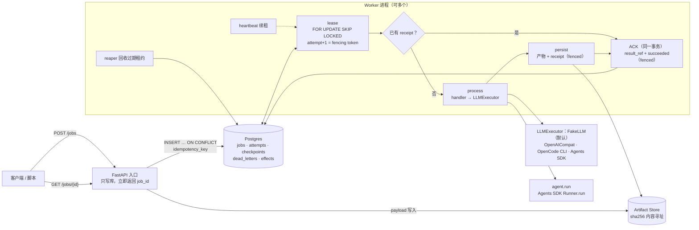
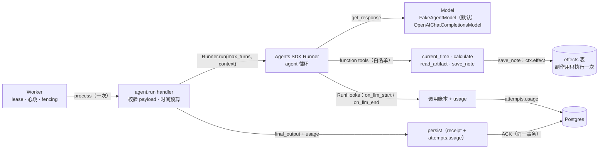

# personal-agent

一个以**异步任务队列**为核心的个人助理型 Agent。当前是 **M0.2：可靠的单队列骨架 + OpenAI Agents SDK 执行后端**。

- 提交与执行分离：`POST /jobs` 只写库并返回 `job_id`，Worker 在后台消费。
- Postgres 同时充当 Broker 和 State Store：`FOR UPDATE SKIP LOCKED` 领任务，用租约加心跳占用执行权，过期租约自动回收。
- **先持久化，再 ACK**：结果产物写入内容寻址存储并记录 durable receipt；ACK 在一个事务里同时写结果和改状态。
- **至少一次投递 + 幂等**：`idempotency_key` 去重；Worker 执行前先查回执，崩溃恢复时不会重复调用模型。
- **fencing token**：`attempt` 每次 lease 加 1，过期租约持有者的所有写入都会被拒绝。
- 默认使用确定性的 fake LLM，不需要 API key；预留了 OpenAI 兼容接口（`PA_LLM=openai`）和 OpenCode CLI（`PA_LLM=opencode`）。
- **Agent 执行后端**：用 [OpenAI Agents SDK](https://openai.github.io/openai-agents-python/)（`openai-agents`）跑带工具白名单的 `agent.run` 任务，见[下文](#agent-执行后端openai-agents-sdk)。

设计文档见 [docs/design.md](docs/design.md)，M0 验收报告见 [docs/m0-test-report.md](docs/m0-test-report.md)。

给智能体（和新贡献者）的仓库地图见 [AGENTS.md](AGENTS.md)：分层见 [ARCHITECTURE.md](ARCHITECTURE.md)，可靠性不变量见 [RELIABILITY.md](RELIABILITY.md)，执行计划约定见 [PLANS.md](PLANS.md)。

## 架构



任务状态（M0）：`queued → leased → succeeded`；失败时 `leased → retry_wait →（退避到期）→ leased`；超过重试上限或遇到不可重试错误时进入 `dead`，并写一条 `dead_letters` 记录；租约过期后回到 `queued`。

| 崩溃位置 | 恢复行为 |
|---|---|
| 持久化之前 | 没有回执；租约过期后重新投递，重新执行一次 |
| 持久化之后、ACK 之前 | 回执已落盘；新 worker 直接用回执 ACK，**不再调用模型** |
| 旧持有者恢复后继续写 | fencing 条件不满足，写入影响 0 行，抛 `LeaseLost` 后放弃 |

## 目录

```text
personal_agent/
  core/        storage.py（内容寻址存储，改编自 security-agent）· executor.py（LLM 执行端口）
               context.py（JobContext：complete / step 检查点 / effect 副作用账本）· errors.py
  queue/       broker.py（Postgres 队列）· worker.py（主循环）· faults.py（测试用故障注入）
  api/         app.py（POST /jobs、GET /jobs/{id}、/healthz）
  infra/       fake_llm.py · openai_compat.py · opencode_cli.py · ledger.py · llm.py（按 PA_LLM 选择）
               agents_sdk.py（Agents SDK：FakeAgentModel、模型选择、tracing、账本 hooks、异常映射）
  tasks/       demo.py（demo.summarize）· agent.py（agent.run 与内置工具）
migrations/    0001_init.sql · 0002_attempt_usage.sql（attempts.usage）
tests/         test_acceptance.py（6 条验收）· test_unit.py · test_opencode.py
               test_agents_unit.py · test_agent_acceptance.py（agent.run）
scripts/       run-local.sh · stop-local.sh · render_test_report.py
evals/         agent.run 的评测：34 个任务、评分器、pass^k、门禁、裁判校准（见 evals/README.md）
```

## 本地运行

需要 Python 3.12+ 和 PostgreSQL（推荐 17）。

```bash
# 1) 起 Postgres（二选一）
docker compose up -d                       # 用 docker-compose.yml，会同时创建 personal_agent_test 测试库
# 或者用本机已经安装的 Postgres：创建用户 personal_agent，以及 personal_agent、personal_agent_test 两个库

# 2) 配置
cp .env.example .env                       # 修改 DATABASE_URL / TEST_DATABASE_URL；.env 不会被提交

# 3) 安装
python3.12 -m venv .venv && .venv/bin/pip install -e '.[dev]'   # 或者 uv venv -p 3.12 && uv pip install -e '.[dev]'

# 4) 迁移（两种方式都可以）
.venv/bin/python -m personal_agent migrate
# psql "$DATABASE_URL" -f migrations/0001_init.sql -f migrations/0002_attempt_usage.sql

# 5) 启动 API 和 worker（后台运行，日志在 var/log/）
./scripts/run-local.sh                     # API 在 127.0.0.1:8080
# 前台运行：
# .venv/bin/python -m personal_agent api --port 8080
# .venv/bin/python -m personal_agent worker --concurrency 4 --lease-seconds 30

# 6) 试一下
curl -s -XPOST localhost:8080/jobs -H 'content-type: application/json' \
  -d '{"task_type":"demo.summarize","payload":{"text":"第一句。第二句。第三句。第四句。"},"idempotency_key":"demo-1"}'
curl -s "localhost:8080/jobs/<job_id>?include_result=true"

./scripts/stop-local.sh                    # 优雅停止
```

给智能体用的隔离实例（自己的数据库、JSON 日志、指标和预算检查）：`make dev-up`、`make runtime-check`，见 [RELIABILITY.md](RELIABILITY.md)。

注意：已经导出到 shell 的环境变量优先于 `.env`。worker 启动日志里的 `worker_start` 事件会打印实际连接的库名（不含密码），启动后可以用它确认没有连错库。

接真实模型：设置 `PA_LLM=openai`、`PA_LLM_BASE_URL`、`PA_LLM_API_KEY`、`PA_LLM_MODEL`（任意 OpenAI 兼容的 `/chat/completions`）。密钥只从环境变量读取。M0 的测试只用 fake LLM。

## 接入真实模型（OpenCode）

默认 `PA_LLM=fake`，不会调用任何真实模型。可选两条路径：

| 方式 | 配置 | 能用的模型 | 是否需要 key |
|---|---|---|---|
| OpenCode CLI | `PA_LLM=opencode`，可选 `PA_OPENCODE_MODEL`（默认 `opencode/deepseek-v4.1-flash-free`）、`PA_OPENCODE_BIN` | 免费模型 + 付费模型 | 免费模型不需要；受免费额度限制 |
| OpenAI 兼容 HTTP | `PA_LLM=openai`，`PA_LLM_BASE_URL=https://opencode.ai/inference/openai/v1`，`PA_LLM_MODEL=<付费模型>`，`OPENCODE_API_KEY=oc_sk_...`（或 `PA_LLM_API_KEY`） | 只有付费模型 / Go | 需要 |

为什么免费模型只能走 CLI：官方文档写明免费聊天模型只能在 OpenCode 内使用，其他客户端即使带 Console API key 也会收到 HTTP 403（[harnesses](https://opencode.ai/docs/console/harnesses/)，[models](https://opencode.ai/docs/console/models/)）。

`PA_LLM=opencode` 的适配器（`personal_agent/infra/opencode_cli.py`）会：
- 在临时目录里运行 `opencode run --standalone --format json --model <模型> <prompt>`；
- 使用独立的 XDG 目录，并通过 `OPENCODE_CONFIG_CONTENT` 关闭自动更新和分享，拒绝所有工具权限；
- 超时后杀掉整个进程组；
- 把 429 / `provider.free-limit` 映射成 `RateLimited`，带上 `retry_after`。broker 至少会等这么久再重试，所以额度用完时任务进入 `retry_wait`，而不是 `dead`。

免费模型的数据条款各不相同：有的会把数据用于训练，有的只供试用、要求不要提交个人或机密数据，还有区域限制。官方说明这些模型只是“限时免费”。提交前请先看 [models 页面的 Free models / Privacy 部分](https://opencode.ai/docs/console/models/)；自己使用 OpenCode CLI 时，可以设置 `OPENCODE_DISABLE_FREE_MODELS=1` 隐藏免费模型。

真实模型验证（额度可用时）：

```bash
export PATH=~/.npm-global/bin:$PATH        # opencode CLI 所在位置
PA_LLM=opencode PA_LLM_LEDGER=var/llm-ledger.jsonl .venv/bin/python -m personal_agent worker --worker-id live
.venv/bin/python scripts/opencode-live.py 5             # 提交 5 个 demo.summarize，打印耗时、tokens 和输出
PA_ACCEPTANCE_LLM=opencode .venv/bin/python -m pytest -q tests/test_acceptance.py -k after_persist   # 真实模型下的 kill -9 测试
```

`PA_LLM_LEDGER` 会给任意后端记账：每次调用模型前追加一行并 fsync，用来证明崩溃恢复时没有重复调用模型。

## Agent 执行后端（OpenAI Agents SDK）

`agent.run` 任务用 [OpenAI Agents SDK](https://openai.github.io/openai-agents-python/)（Python 包 `openai-agents`，在 0.25.0 上测试过）运行一个 `Agent`。SDK 只负责 agent 循环本身（调用模型、执行工具、再调用模型）；租约、persist-then-ack、重试、死信、幂等仍然由队列负责。



**任务 payload**

```json
{"task_type": "agent.run",
 "payload": {"instructions": "用工具回答。", "input": "……",
             "tools": ["calculate", "read_artifact"],
             "artifacts": {"doc": {"uri": "artifact://sha256/…", "sha256": "…", "size": 123}},
             "max_turns": 6, "timeout_s": 60},
 "idempotency_key": "agent-1"}
```

| 字段 | 说明 |
|---|---|
| `instructions` / `input` | 系统指令（≤ 8000 字符）和用户输入（≤ 32000 字符） |
| `tools` | 允许使用的工具，只能从内置工具里选；默认一个都不给。模型调用白名单外的工具时，SDK 报 `ModelBehaviorError`，这次 attempt 按可重试失败处理 |
| `artifacts` | `read_artifact` 只能读这里列出的产物，读时校验 sha256 |
| `max_turns` | 默认 6，上限 `PA_AGENT_MAX_TURNS_CAP`（默认 12）。超出时 SDK 抛 `MaxTurnsExceeded`，映射为可重试错误 `max_turns`，重试耗尽后进死信 |
| `timeout_s` | 整个 `Runner.run` 的时间预算，默认 120 秒；同时不超过任务超时减 5 秒（留给 persist/ACK），也不超过 `deadline_at` |

**内置工具**（都不访问网络，也不执行 shell）

| 工具 | 作用 | 副作用 |
|---|---|---|
| `current_time(tz)` | 返回当前时间（ISO 8601） | 无 |
| `calculate(expression)` | 用 AST 白名单计算算术表达式，只支持数字、括号和 `+ - * / // % **`，指数和长度都有上限 | 无 |
| `read_artifact(name)` | 读 `payload.artifacts` 里列出的文本产物，最多 16000 字符 | 无 |
| `save_note(title, text)` | 把一条笔记写进本地 Artifact Store | 有：走 `ctx.effect`，键是 `job_id + 参数哈希`，同一个任务重跑时不会再执行 |

**和队列语义的结合**

- 整个 `Runner.run` 是一次 process 步骤，结果走 persist-then-ack。persist 之后崩溃，新 worker 直接用 receipt ACK，**不会重跑 Runner**（`test_agent_kill9_after_persist_does_not_rerun_runner`）。
- persist 之前崩溃会重跑 Runner（模型会再被调用），但 `save_note` 这类副作用通过 effects 表去重，只执行一次（`test_agent_kill9_before_persist_reruns_runner_but_not_effect`）。
- 心跳发现租约丢失时，正在进行的 `Runner.run` 会被取消，抛 `LeaseLost`。
- 每次模型调用前，`RunHooks.on_llm_start` 会在调用账本里追加一行并 fsync；调用结束后，`on_llm_end` 把这次的 usage（requests、input/output/total tokens）记进 `ctx.usage`。persist 时随 receipt 写进 `attempts.usage`，失败的 attempt 也会写。结果里还有 SDK 汇总的 `result.context_wrapper.usage`。
- SDK 自带的模型重试默认是关闭的（[官方说明](https://openai.github.io/openai-agents-python/models/)：需要显式配置 `ModelSettings(retry=...)` 才会重试）。真实模型的 `AsyncOpenAI` 客户端也设置了 `max_retries=0`，重试统一交给队列。

**Tracing**：SDK 默认开启 tracing，并会把数据上传到 OpenAI（[官方说明](https://openai.github.io/openai-agents-python/tracing/)）。这里改成：

| `PA_AGENTS_TRACING` | 行为 |
|---|---|
| `off`（默认） | 导入 SDK 前设置 `OPENAI_AGENTS_DISABLE_TRACING=1`，并调用 `set_tracing_disabled(True)`、`set_trace_processors([])`，每次运行再传 `RunConfig(tracing_disabled=True)` |
| `local` | 用 `set_trace_processors([LocalJsonlTraceProcessor])` **替换**默认的 OpenAI 导出器，trace 和 span 写到 `PA_AGENTS_TRACE_FILE`（默认 `var/agent-traces.jsonl`）。默认 `trace_include_sensitive_data=False`，不记录模型输入输出；设置 `PA_AGENTS_TRACE_SENSITIVE=1` 才记录 |

**模型**

| `PA_AGENT_MODEL` | 模型 | 说明 |
|---|---|---|
| `fake`（默认） | `FakeAgentModel` | 实现 SDK 的自定义 `Model` 接口，离线、确定性。输入里写 `@tool <name> <json 参数>` 时，第一轮发出这些工具调用，拿到结果后给出最终回答；写 `@loop` 时每轮都调用 `current_time`，用来测 `max_turns`；没有指令时返回输入的前几句 |
| `openai` | `OpenAIChatCompletionsModel` + `AsyncOpenAI(base_url=…)` | 任意 OpenAI 兼容的 `/chat/completions`，即官方文档里接非 OpenAI 服务的写法 |
| `py:<模块>:<类名>` | 自定义 SDK `Model` | 导入模块后无参构造这个类；评测用它接入离线脚本策略 `py:evals.policy:ScriptedAssistantModel` |

`PA_LLM=agents` 时，`demo.summarize` 这类只用 `LLMExecutor` 的任务也会经过 Agents SDK（单轮、无工具，模型同样由 `PA_AGENT_MODEL` 决定）。`agent.run` 不受 `PA_LLM` 影响，始终使用 Agents SDK。

**接真实模型**（目前还没有用真实模型跑过，下面只是配置方法）：

```bash
export PA_AGENT_MODEL=openai
export PA_LLM_BASE_URL=https://api.openai.com/v1            # 或任意 OpenAI 兼容端点，例如 https://opencode.ai/inference/openai/v1
export PA_LLM_MODEL=<模型名>
export PA_LLM_API_KEY=...                                   # 也可以用 OPENAI_API_KEY 或 OPENCODE_API_KEY；只从环境变量读取，不要写进仓库
export PA_LLM_LEDGER=var/llm-ledger.jsonl                   # 可选：调用账本
.venv/bin/python -m personal_agent worker --worker-id agent-live
curl -s -XPOST localhost:8080/jobs -H 'content-type: application/json' -d '{"task_type":"agent.run",
  "payload":{"instructions":"需要计算时用 calculate 工具。","input":"(3+4)*12 等于多少？","tools":["calculate"]},
  "idempotency_key":"agent-live-1"}'
```

注意：

- 端点需要支持 Chat Completions 的 function calling，工具才能用。
- OpenCode 的免费模型只能在 OpenCode 客户端里用，走 OpenAI 兼容接口会收到 403（[官方说明](https://opencode.ai/docs/console/harnesses/)），所以不能给 `PA_AGENT_MODEL=openai` 用。
- SDK 也支持通过 LiteLLM（`openai-agents[litellm]`）接其他服务，但官方说明这是 beta、尽力而为的支持（[models 文档](https://openai.github.io/openai-agents-python/models/)），这里没有接入。

## 测试

```bash
.venv/bin/python -m pytest -v            # 需要 TEST_DATABASE_URL；每个测试开始前会清空测试库
python scripts/render_test_report.py      # 把 test-results/acceptance-metrics.json 渲染成 docs/m0-test-report.md
```

| 测试 | 验收标准 | 做法 |
|---|---|---|
| `test_1_*` | 提交后 100 ms 内返回 `job_id` | 预热 5 次后顺序 POST 100 次，最慢一次必须 < 100 ms |
| `test_2_*` | 同一个幂等键提交两次返回同一个任务 | 顺序提交两次，再用 20 个线程并发提交；同一个键配不同 payload 返回 409 |
| `test_3_*` | 持久化之前 kill -9，任务被重投并完成 | 故障点 `before_persist` 让 worker A 停住，测试进程对它发 `SIGKILL`；worker B 回收租约后完成任务 |
| `test_4_*` | 持久化之后、ACK 之前 kill -9，模型不被重复调用 | 故障点 `after_persist` + `SIGKILL`；用 fake LLM 的 fsync 调用账本确认总调用次数 = 1 |
| `test_5a_*` / `test_5b_*` | 租约过期的旧 worker 写入被拒 | 5a：`SIGSTOP` 冻结 A，等 B 完成后 `SIGCONT` A，确认 A 的 persist 被拒；5b：在 broker 层分别验证过期后、被重新 lease 后的 persist、ack、fail、heartbeat 都被拒 |
| `test_6_*` | 两个 worker 并发消费 200 个任务，不重复不遗漏 | 两个 worker 进程，每个并发 8；核对 attempts 表和调用账本：200 个任务各执行恰好 1 次 |

最近一次的实测数字见 [docs/m0-test-report.md](docs/m0-test-report.md)。

agent.run 的测试（`tests/test_agents_unit.py` 有 11 个离线单测，`tests/test_agent_acceptance.py` 有 4 个进程级验收）覆盖工具调用、白名单、payload 校验、max_turns 超限后失败、重试和进死信、effect 去重、租约丢失和超时取消 Runner、persist 前后的 kill -9，以及 tracing 不上传。实测数字见 [docs/m0.2-agents-test-report.md](docs/m0.2-agents-test-report.md) 和 `test-results/agent-metrics.json`。

## 评测（evals/）

测试回答“队列和 agent 循环有没有按设计工作”；评测回答“换了模型、提示词或工具之后，助理是变好还是变差”。`evals/` 按手册[第 16 章](https://atituiset.github.io/agent-engineering-handbook/handbook/16-agent-evals)的做法实现：

- 34 个任务：27 个个人助理任务（查时间、计算、读文档、存笔记、安全、不该用工具，其中 4 个是能力集）和 7 个系统检查（max_turns 进死信、不可重试错误、副作用去重、persist 前后 `kill -9`、重复入队）。
- 任务走真实的 worker 进程、Postgres 和 Agents SDK；判分读数据库、Artifact Store 和调用账本，看工具选择和参数、副作用条数、系统不变量，不信模型自己的回答。
- 每个任务跑多次，报告 pass@k、pass^k、Wilson 95% 区间、token 和耗时；`evals/gate.py` 与 `evals/baseline.json` 比较，回归、违规或 token 上涨超过 25% 就失败；`.github/workflows/evals.yml` 在 CI 里用 `postgres:17` 跑这一套。
- 默认模型是离线的脚本策略 `ScriptedAssistantModel`（`PA_AGENT_MODEL=py:evals.policy:ScriptedAssistantModel`），CI 不需要密钥。

```bash
.venv/bin/python -m evals.run_evals --trials 5 --k 1 3 5 --out test-results/evals-results.json   # 需要 EVAL_DATABASE_URL
.venv/bin/python -m evals.gate --baseline evals/baseline.json --current test-results/evals-results.json --k 3
```

本机实测（2026-11-25，每个任务 5 次）：基线回归集 150/150、能力集 10/20，重跑过门禁；让英文城市名退回 UTC 后回归集 140/150、门禁失败；把 effect 键改成带 attempt 号后 `sys_kill9_before_persist` 0/5、门禁失败；只会声称“已保存”的作弊策略被记下 45 次违规。这些数来自脚本策略，只说明评测本身能工作。接真实模型（`--model openai` 或 `--model py:<模块>:<类名>`）的方法和注意事项见 [evals/README.md](evals/README.md)。

## 代码出处

- `personal_agent/core/storage.py` 中的 `atomic_json`、`digest`、`seal`、`verify` 改编自同一作者的 [security-agent](https://github.com/Atituiset/security-agent) 中的 `security_agent/core/storage.py`。
- `core/executor.py` 的执行端口思路来自 security-agent 的 `core/executor.py`。
- `JobContext.step` 的 `input_hash` 重放规则来自 security-agent 的 `pipeline/controller.py`。
- `test_unit.py::test_core_has_no_infra_or_driver_imports` 沿用了 security-agent 的 `tests/test_architecture.py`。

security-agent 仓库没有附许可证文件，这些代码由原作者在本仓库以 MIT 许可证重新发布。

## 路线图

| 里程碑 | 内容 |
|---|---|
| **M0** | Postgres 队列、lease、心跳、reaper、persist-then-ack、幂等、fencing、`demo.summarize`、6 条验收测试 |
| **M0.1** | OpenCode CLI 适配器（`PA_LLM=opencode`），`RateLimited` + `retry_after`，通用调用账本 |
| **M0.2（当前）** | OpenAI Agents SDK 执行后端：`agent.run` 任务、工具白名单、effect 去重、`attempts.usage`、本地 tracing |
| **M1** | 接入真实 LLM 后端（包括复用 security-agent 的 Claude Agent SDK、OpenCode、Hermes 适配器）；按 llm、io、cpu 拆分 worker pool；按模型同时限制 RPM 和 TPM 的双令牌桶；token 和费用记账；DLQ 命令行（`dlq ls/show/requeue`）；Scheduler（cron，`Asia/Shanghai`，触发幂等）；真实任务：资讯采集与摘要、论文精读 |
| **M2** | 用 `parent_job_id` 实现 fan-out/fan-in 和线性依赖；长任务的 `step` 断点续跑；人工审批（`waiting_human`，审批过期不自动执行）；有界队列、准入控制、优先级与老化、用户级和任务类型级配额 |
| **M3** | OpenTelemetry trace 和 metrics（6 个队列指标加 token 和成本）、看板；事件源（GitHub webhook、RSS）；`code.review` 任务接入 security-agent；扩展故障注入矩阵 |

## 许可证

[MIT](LICENSE)
