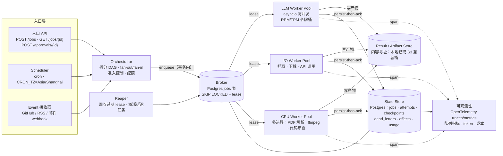
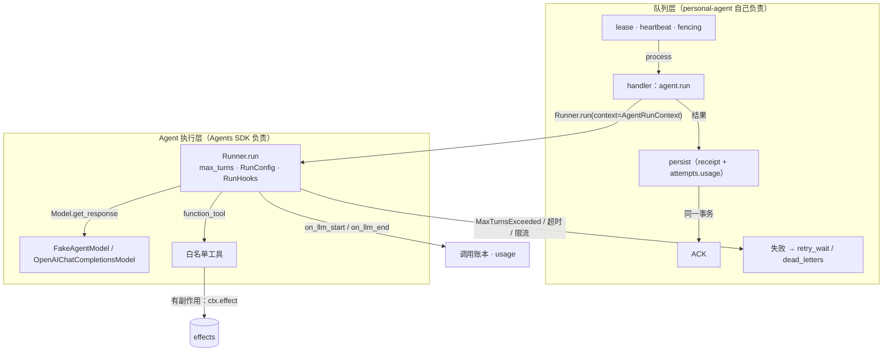
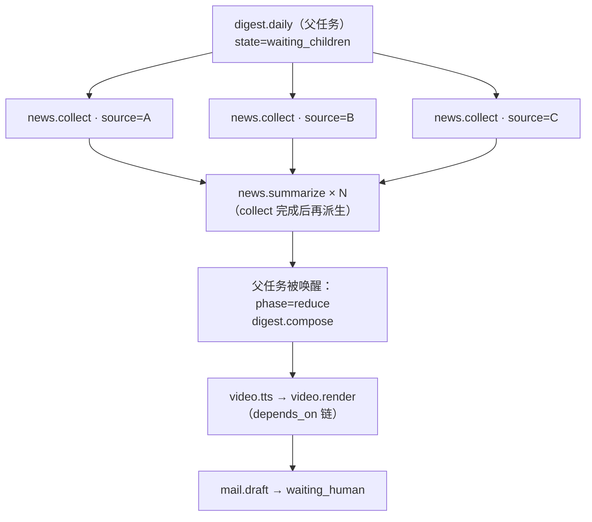
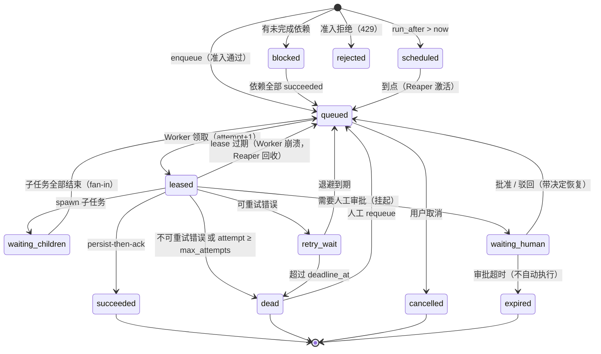
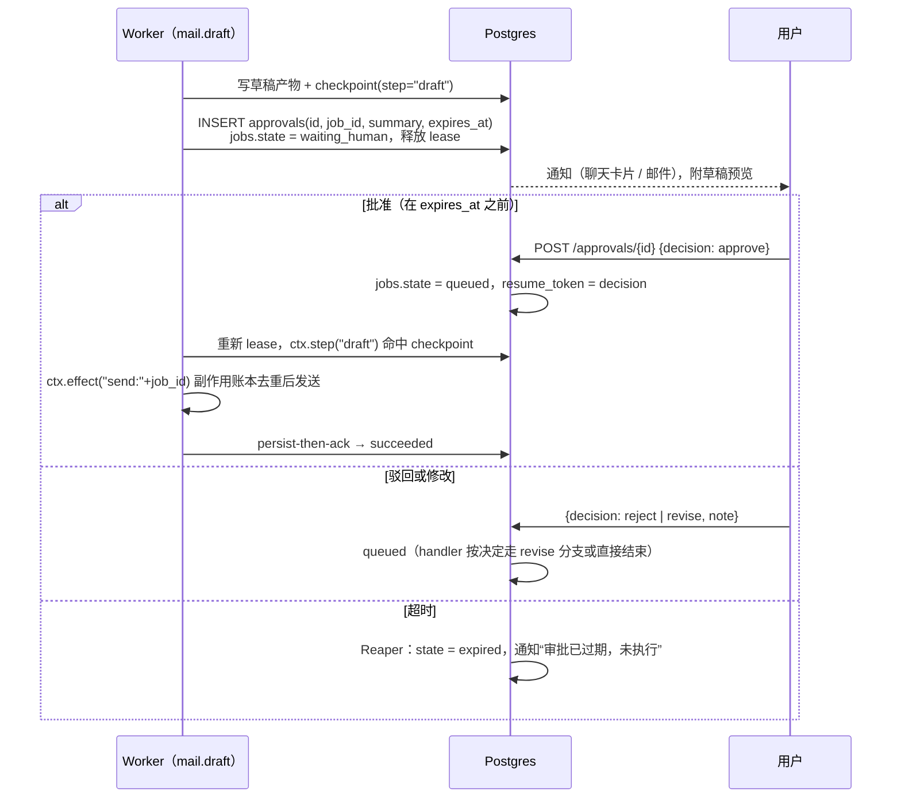

# personal-agent 设计方案：以异步任务队列为核心的个人助理 Agent

> 版本 v0.1（2026-11-19，北京时间）。参考两份材料：「Agent 任务队列」系列图文的整理稿，以及 security-agent 现状与差距的对照分析。
> 语言与 security-agent 保持一致：**Python ≥ 3.11**（security-agent 的 `pyproject.toml` 写的是 `requires-python = ">=3.11"`）。

---

## 0. 设计原则（多数从 security-agent 继承）

1. **提交与执行分离**：任何入口只负责“写入一条任务并返回 `job_id`”，执行全部放在 Worker 里。
2. **先持久化，再确认**：结果和回执落盘之后才 ACK。这条对应 security-agent `pipeline/controller.py` 里“Durable receipt precedes checkpoint projection”的纪律。
3. **至少一次投递 + 业务幂等**：重复投递是正常情况，靠 `idempotency_key`、`action_id + input_hash` 和副作用账本把重复变成无害。
4. **失败不冒充成功**：沿用 security-agent“UNKNOWN 和执行失败不当成无漏洞”的态度。超时、预算耗尽、等待审批都是明确的状态，不能静默吞掉。
5. **对外副作用默认要人工审批**：发邮件、发帖、推代码这类任务一律走 human-in-the-loop，审批过期就停下，不自动执行。
6. **个人项目优先简单**：组件尽量少、能一键部署（Railway），等量级上来再换 broker。

---

## 1. 定位与任务来源

**定位**：一个长期在线的个人助理型 Agent，帮我把重复性的信息处理和内容生产自动化，例如每天的资讯早报、论文精读、视频生成、邮件草稿、代码审查。

| 来源 | 例子 | 入口组件 | 默认优先级 |
|---|---|---|---|
| 用户请求 | 聊天里说“帮我精读这篇论文”“审查这个 PR” | 入口 API（HTTP 或聊天 webhook） | P1（交互） |
| 定时任务 | 每天 05:00（北京时间）的 AI 早报、21:00 的论文精读、每周日的周报 | Scheduler（cron 表达式，`CRON_TZ=Asia/Shanghai`） | P2 |
| 外部事件 | GitHub push/PR webhook、RSS 有新条目、邮箱收到特定邮件 | Event 接收器 | P2 / P3 |
| Agent 自己拆出来的子任务 | 早报任务拆成“采集 × N → 摘要 × N → 汇总 → 配音 → 视频合成” | Orchestrator | 继承父任务 |

**任务类型示例**（`task_type`，按资源特征分配到不同的 pool）：

| task_type | 说明 | 主要资源 | Pool |
|---|---|---|---|
| `news.collect` | 抓 RSS、X、网页 | 网络 I/O | io |
| `news.summarize` | 单条资讯摘要 | LLM | llm |
| `digest.compose` | 汇总成早报（fan-in） | LLM | llm |
| `paper.fetch` / `paper.read` | 下载 PDF、解析、精读 | I/O / CPU / LLM | io / cpu / llm |
| `video.tts` / `video.render` | 配音、ffmpeg 合成 | 网络 / CPU | io / cpu |
| `mail.draft` | 写邮件草稿，**挂起等审批**后再发 | LLM + HITL | llm |
| `code.review` | 调用 security-agent CLI 或其他审查器 | 子进程 + LLM | cpu |

---

## 2. 分层架构



说明：

- **Broker 和 State Store 共用一个 Postgres**。这样 ACK 和“写结果、改状态”能放进同一个数据库事务，persist-then-ack 天然是原子的。这是个人项目选 Postgres 队列的主要理由（见第 9 节）。
- **Artifact Store 按内容寻址**（`sha256`），直接复用 security-agent 的 `core/storage.py`（`atomic_json`、`seal`、`verify`）。同一份产物重复写入是幂等的。
- 三个 pool 是**同一个代码库、不同的启动参数**（`personal-agent worker --pool llm`），在 Railway 上部署成三个 service，各自扩容。
- Orchestrator 不是单独的进程，而是 API、Scheduler、Event 和 Worker 都会调用的一个库。Worker 执行父任务时也可以调用它来派生子任务。

### 2.1 Agent 执行层：OpenAI Agents SDK（M0.2 起）

用户选定 [OpenAI Agents SDK](https://openai.github.io/openai-agents-python/)（`openai-agents`）作为 agent 的执行后端。它在架构里的位置是 **LLM Worker 里、handler 之下的一层**：worker 只把整个 `Runner.run` 当成一次 process 步骤，不知道里面有几轮模型调用和工具调用；SDK 也不知道队列的存在。



边界约定：

| 关注点 | 由谁负责 | 做法 |
|---|---|---|
| 重试、退避、死信 | 队列 | SDK 的模型重试默认关闭（需显式配置 `ModelSettings(retry=...)`），真实模型客户端 `max_retries=0`；SDK 异常映射为 `Retryable` / `Fatal` / `RateLimited` / `max_turns` |
| 崩溃恢复 | 队列 | persist 之后崩溃直接用 receipt ACK，不重跑 Runner；persist 之前崩溃会重跑 Runner |
| 工具副作用 | 工具 + `ctx.effect` | 副作用工具用 `job_id + 参数哈希` 作为 effect 键，重跑时直接返回第一次的回执；"started 但没有回执" 交给人工确认，中止这次运行 |
| 轮数与时间 | 两者 | `max_turns`（payload 指定，有上限）；整个 run 的时间预算不超过 payload、任务超时和 `deadline_at`；单次模型调用用 `ModelSettings.timeout`；租约丢失时取消 run |
| 用量 | SDK → 队列 | `RunHooks.on_llm_end` 拿到每次调用的 `Usage`，写进 `attempts.usage`；`result.context_wrapper.usage` 是整次 run 的汇总 |
| Tracing | 队列配置 SDK | 默认关闭；`local` 模式用本地 JSONL 处理器替换默认的 OpenAI 导出器，不上传 |

为什么不用 SDK 自带的会话（Session）或 `RunState` 做断点续跑：M0.2 的 agent 任务都很短，以“整次 run”为单位重做的成本可以接受；副作用已经通过 effects 去重。之后如果需要在长 run 中途做 checkpoint，可以用 `RunResult.to_state()` 序列化的状态配合 `JobContext.step` 落盘（[官方说明](https://openai.github.io/openai-agents-python/running_agents/)：`Runner.run` 可以接收 `RunState` 恢复运行），这留到 M2。

---

## 3. 任务消息 schema

消息只放执行需要的最小信息，大对象一律用 `payload_ref` 引用。

```json
{
  "job_id": "0193f6c2-7a1e-7c3b-9d1e-5b2a9e0c4f11",
  "task_type": "news.summarize",
  "payload_ref": {"uri": "artifact://sha256/9f2c…/input.json", "sha256": "9f2c…", "size": 18342},
  "priority": 2,
  "idempotency_key": "news.summarize:2026-11-19:https://example.com/post/123",
  "trace_id": "4bf92f3577b34da6a3ce929d0e0e4736",
  "deadline_at": "2026-11-19T04:50:00+08:00",
  "attempt": 1,
  "parent_job_id": "0193f6c2-0000-7000-8000-000000000001",
  "user_id": "frank",
  "pool": "llm",
  "max_attempts": 5,
  "schema_version": 1
}
```

| 字段 | 类型 | 说明 |
|---|---|---|
| `job_id` | UUIDv7 | 全局唯一，大致按时间有序，方便排序和分区 |
| `task_type` | str | 决定 handler、pool、默认配额和重试策略 |
| `payload_ref` | `{uri, sha256, size}` | 输入数据的引用，格式沿用 security-agent `seal()` 产出的 `{path, sha256}`；Worker 读取后要校验哈希 |
| `priority` | int 0–9 | 数字越小越优先：0 系统、1 交互、2 定时、3 事件、5 批量回填 |
| `idempotency_key` | str | 业务去重键，数据库里有 `UNIQUE` 约束；同一个键重复提交时返回已有的 `job_id` |
| `trace_id` | 32 位十六进制 | W3C Trace Context 的 trace-id，入队时由 API 的 span 生成，Worker 继承 |
| `deadline_at` | timestamptz | 期望完成时间：参与调度排序；过期后按策略取消或降级 |
| `attempt` | int | 当前第几次执行（每次 lease 加 1），同时充当 **fencing token** |
| `parent_job_id` | UUID 或 null | 父任务；用来实现 fan-out/fan-in 和 DAG |
| `user_id` / `pool` / `max_attempts` / `schema_version` | — | 配额、路由、重试上限、消息版本 |

### 3.1 用 parent_job_id 拆子任务（fan-out / fan-in 与 DAG）



- **fan-out**：父任务的 handler 调用 `ctx.spawn([...])`，在**同一个事务里**插入子任务、把父任务的 `pending_children` 设为子任务数量、把父任务状态改成 `waiting_children` 并释放 lease。父任务这时不占用 worker。
- **fan-in**：每个子任务进入终态（succeeded / dead / cancelled）时，在同一事务里执行 `UPDATE jobs SET pending_children = pending_children - 1 WHERE job_id = parent`。减到 0 时把父任务改回 `queued`，并设 `phase='reduce'`。父任务重新执行时从 checkpoint 继续，读取所有子任务的 `result_ref` 做汇总。
- **子任务失败的策略**由父任务声明：`all_or_nothing`（任何一个子任务进入 dead，父任务就失败）或者 `best_effort`（允许部分失败，汇总时标注缺口，和 security-agent “覆盖缺口必须可见”的原则一致）。
- **DAG**：用 `job_deps(job_id, depends_on)` 边表。所有依赖都 succeeded 之后，任务才从 `blocked` 变成 `queued`。第一版只支持 fan-out/fan-in 加线性 `depends_on`，不做任意的动态 DAG 编辑。

---

## 4. 状态机、重试、退避与 DLQ



这里的状态与图文的 `Created / Waiting / Delayed / Active / Completed / Failed / DLQ` 一一对应：`queued` 是 Waiting，`scheduled` 和 `retry_wait` 是 Delayed，`leased` 是 Active，`succeeded` 是 Completed，`dead` 对应 DLQ。

**错误分类**（handler 抛出的异常类型决定下一步走向）：

| 类别 | 例子 | 处理 |
|---|---|---|
| `Retryable` | 网络超时、HTTP 429/5xx、模型过载 | 进入 `retry_wait`，指数退避 |
| `RateLimited(retry_after)` | 本地令牌桶不够，或者上游返回了 `Retry-After` | 进入 `retry_wait`，`run_after = now + retry_after`，**不计入 attempt**（不算失败） |
| `Fatal` | 输入校验失败、payload 哈希不匹配、契约校验失败（`ContractError`） | 直接 `dead` |
| `BudgetExhausted` | 单任务或用户的美元、调用次数预算用完 | `dead`，原因写 `budget`（对应 security-agent 的 `BUDGET_EXHAUSTED`） |
| `Stale` | 输入基线变了，比如仓库 HEAD 移动 | `dead`，原因写 `stale`，提示重新提交（对应 `STALE`） |

**退避公式**（带完全抖动）：`delay = random(0, min(cap, base × 2^(attempt−1)))`，默认 `base=5s`、`cap=15min`；LLM 任务的 `cap=30min`。如果上游带了 `Retry-After`，就取两者中较大的值。

**DLQ**：不单独建一个队列，而是“`state='dead'` 加一条 `dead_letters` 记录”，内容包括最后的错误、全部 attempt 回执的引用和 `trace_id`。提供 `personal-agent dlq ls / show / requeue <job_id> [--reset-attempts]`。requeue 不改 `idempotency_key`，handler 里的副作用账本保证不会重复执行副作用。

---

## 5. 并发与限流

### 5.1 三类 Pool

| Pool | 执行模型 | 默认并发 | 限制因素 |
|---|---|---|---|
| `llm` | 单进程 asyncio，一个 worker 管多个在途任务 | 16 个协程槽 | 模型 RPM/TPM 令牌桶、美元预算 |
| `io` | 单进程 asyncio | 32 | 每个域名的并发和速率、外部 API 配额（例如 X API 每分钟 30 次、每天 1000 次） |
| `cpu` | 进程池（`ProcessPoolExecutor` 或子进程，复用 `infra/local_process.py`） | 等于 CPU 核数 | CPU、内存、文件句柄 |

图文里的“并发 vs 并行”就落在这里：LLM 和 I/O 用**并发**（等待型任务，同一进程推进多个），CPU 用**并行**（多进程）。

### 5.2 令牌桶：同时按 RPM 和 TPM 限流

每个 `provider:model` 有两个桶：

- **RPM 桶**：容量 `rpm`，每秒补充 `rpm/60` 个令牌，每次请求消耗 1 个。
- **TPM 桶**：容量 `tpm`，每秒补充 `tpm/60` 个令牌。请求前**预扣** `estimate = prompt_tokens_estimate + max_output_tokens`，返回后按实际 `usage` **多退少补**。

两个桶都够才放行（`acquire_all`）。如果需要等待的时间超过 `max_wait`（默认 2 秒），**不要让 worker 原地睡眠占着槽位**，而是抛出 `RateLimited(retry_after)`，让任务回到 `retry_wait`，并且不计入 attempt。

桶的状态存放位置：M1 阶段 LLM pool 只有一个进程，桶放内存就够；M2 阶段有多个 LLM worker 实例后，改成存到 Postgres `rate_buckets` 表，用一条 `UPDATE … RETURNING` 原子扣减（见第 11 节代码）。

### 5.3 配额

| 维度 | 配置 | 检查时机 |
|---|---|---|
| 用户级并发 | `user.max_inflight`（例如 8） | lease 时：`leased` 状态的任务数达到上限就跳过该用户的任务 |
| 任务类型并发 | `task_type.max_inflight`（例如 `video.render` = 1） | lease 时 |
| 任务类型每日预算 | `task_type.daily_usd`、`daily_calls` | 入队时做准入检查，执行时在 LLM 调用前预留（沿用 security-agent“预留后不退还”的保守记账） |
| 单任务预算 | `job.max_usd`、`job.max_calls`、`job.max_tokens` | 每次调用 LLM 前 |

---

## 6. 背压

图文里的近似公式 `ΔQ = λ − μ`：只要入队速率长期大于处理速率，就必须有手段把压力反馈给上游。

| 手段 | 设计 |
|---|---|
| **有界队列** | 每个 `task_type` 有 `max_queued`（例如 `news.summarize` = 500，`video.render` = 5）。超出后按来源处理：用户请求返回 **429 加 Retry-After**；定时任务**合并**（同一个 `idempotency_key` 已经在队列里就直接返回已有任务）；外部事件**降级**为 P5 或者丢弃并计数 |
| **准入控制** | 入队前检查：队列深度、`oldest_job_age` 是否超过 SLO、用户和任务类型的每日预算、下游健康度（最近 5 分钟 429 的比例）。不通过就拒绝、延后或降级（比如换便宜的模型、只做摘要不生成视频） |
| **优先级** | lease 时按 `ORDER BY priority, deadline_at NULLS LAST, created_at` 排序；加**老化**机制，等待超过 30 分钟的任务有效优先级提升 1 级，避免低优先级任务饿死 |
| **配额隔离** | 用户级和任务类型级的 `max_inflight`，防止一个批量回填任务占满 LLM pool |
| **扩容不是万能的** | 瓶颈在模型限额时，加 LLM worker 没有用，因为令牌桶是全局的。要看 `rate_limited_wait` 指标判断是该扩容还是该降级 |

---

## 7. 长任务的 checkpoint 和断点续跑；人工审批的挂起与恢复

### 7.1 Checkpoint

security-agent 用 `stages.py checkpoint()` 和 `_prepare()` 的行动级检查点（`snapshot → scope → index → handoff`）实现了“中断后从未完成的那一步继续”。personal-agent 把它做成通用 API：

```python
async def handle_video_daily(ctx: JobContext, payload: dict) -> Result:
    script = await ctx.step("script", lambda: write_script(ctx, payload))   # 已完成就直接读回 checkpoint
    audio  = await ctx.step("tts",    lambda: synthesize(ctx, script))
    video  = await ctx.step("render", lambda: render(ctx, script, audio))
    return Result(artifacts=[video])
```

- `ctx.step(name, fn)`：先查 `checkpoints(job_id, step)`，已经有了就校验 `sha256` 后直接返回；没有就执行 `fn`，把结果写进 Artifact Store，再插入 checkpoint 行。
- 这样每一步都是**幂等**的；Worker 在任何位置崩溃，重投后都会从最后一个完成的 step 继续。
- step 的输入要算哈希（沿用 security-agent `invoke()` 的 `input_hash`），同名 step 输入变了就报错，而不是误用旧结果。
- 运行时间长的 step（比如 ffmpeg 渲染要几分钟）期间，由 heartbeat 协程续租 lease；step 内部也可以调用 `ctx.progress(pct)`。

### 7.2 Human-in-the-loop（HITL）



- 挂起的任务**不占用 worker 和 lease**，只在数据库里留一行状态。
- handler 中的写法：`decision = await ctx.await_human(kind="send_email", preview_ref=..., ttl=timedelta(hours=12))`。第一次执行时抛出 `Suspend` 异常让任务挂起；恢复后再执行到同一处，就会直接返回 `decision`。
- **过期绝不自动执行**：审批过期后状态进入 `expired`，只发通知，要等用户明确说“发”才会重新入队。
- 所有对外副作用都通过 `ctx.effect(key, fn)` 执行：先 `INSERT INTO effects(key) ON CONFLICT DO NOTHING`，插入成功才执行 `fn`；执行完再写回执。这样即使重投，也不会把同一封邮件发两次。如果 `fn` 执行完但回执还没写入时进程崩溃，账本里会留下 `state='started'`，这种情况交给人工确认，不自动重发（宁可漏发，也不重复发）。

---

## 8. 可观测性

### 8.1 指标（OpenTelemetry Metrics，同时导出 Prometheus 格式）

| 指标 | 类型 | 计算方式 / 标签 |
|---|---|---|
| `queue_depth` | Gauge | `count(*) WHERE state IN ('queued','scheduled','retry_wait')`，按 `task_type, pool, priority` |
| `oldest_job_age_seconds` | Gauge | `now() - min(enqueued_at) WHERE state='queued'` |
| `queue_wait_seconds` | Histogram | 每次 lease 时记录 `leased_at - enqueued_at`（或 `run_after`） |
| `processing_seconds` | Histogram | `finished_at - leased_at`，按 `task_type, outcome` |
| `worker_utilization` | Gauge | `在途任务数 / 并发槽数`，按 `pool, worker_id` |
| `job_retries_total` / `dlq_total` | Counter | 按 `task_type, error_class` |
| `llm_tokens_total` | Counter | 按 `provider, model, direction=input/output, task_type` |
| `llm_cost_usd_total` | Counter | 同上；**实际费用拿不到时不算 0**，另计 `llm_cost_unknown_calls_total`（沿用 security-agent `trace.py` 的 `unknown_calls`） |
| `rate_limited_wait_seconds` | Histogram | 令牌桶等待或让出的时长，按 `bucket` |
| `approvals_pending` | Gauge | `waiting_human` 状态的任务数 |

### 8.2 Trace

- 入口 API 收到请求时开启根 span，把 `trace_id` 写进消息；Worker 用 `trace_id` 加上消息里保存的父 span id 恢复上下文（W3C `traceparent`），保证**一条请求从入队到子任务再到 LLM 调用都在同一条 trace 上**。
- span 层级：`enqueue` → `job.lease`（等待时长作为属性）→ `job.process` → `step:<name>` → `llm.call` / `tool.call` / `http.get`。
- `llm.call` 的 span 属性参考 OpenTelemetry GenAI 语义约定（目前还处于开发阶段，字段名可能变化）：`gen_ai.request.model`、`gen_ai.usage.input_tokens`、`gen_ai.usage.output_tokens`，再加上自定义的 `cost_usd`。
- **不在 span 里记录 prompt 原文或个人数据**，只记录产物的引用和哈希。
- 后端：自托管 Grafana 加上 Tempo、Prometheus，或者任意支持 OTLP 的服务；M3 之前可以只用 `ConsoleSpanExporter` 加 SQL 看板。
- 保留 security-agent 的做法：`personal-agent trace <job_id>` **只从持久化产物重建时间线**，不依赖 OTel 后端也能排查问题。

---

## 9. 技术选型对比

> 下表的特性以 2026-11 查阅的官方文档或官方仓库为准，查阅出处列在表后。个人项目的评估维度是：Python 支持、组件数量、能否在 Railway 上部署、lease/重投、DLQ、延迟任务、优先级、限流、DAG/父子任务、人工挂起。

| 方案 | 类型 | Python 支持 | 可靠性语义 | 延迟 / 优先级 / 限流 | 父子任务 / 工作流 | 运维成本（个人项目） | 结论 |
|---|---|---|---|---|---|---|---|
| **BullMQ** | Redis 上的任务队列库 | 有官方 Python 移植版（`pip install bullmq`，与 Node 版用同一套 Lua 脚本、可以互通），但官方 Python README 写明**还没有移植全部功能** | Worker 持锁、自动续租，失败可重试 | 支持延迟、去重、优先级、重试与退避，以及全局并发和速率限制 | Flow Producer（父子任务） | Redis 一个组件 | 主场在 Node；Python 版可用，但功能落后于 Node 版 |
| **RabbitMQ** | 通用消息代理（AMQP） | pika、aio-pika 等客户端 | 手动 ACK、prefetch；quorum queue 支持毒消息处理（投递次数上限）、at-least-once 死信、延迟重试、consumer timeout | 有消息优先级和 TTL；限流要自己实现 | 没有，需要自己实现或配合 Celery、Dramatiq | 要多运维一个 Erlang 服务 | 能力强，但对个人项目偏重 |
| **Amazon SQS** | 托管队列 | boto3 | 可见性超时（默认 30 秒，最长 12 小时）+ redrive 到 DLQ；消息保留最长 14 天 | 单条消息延迟最长 15 分钟；没有优先级（要用多个队列模拟）；单条消息最大 1 MiB | 没有 | 免运维，但要 AWS 账号，不在 Railway 生态内 | 适合已经在 AWS 上的场景 |
| **Redis Streams** | Redis 原生数据结构 | redis-py | 消费组 + `XACK` + PEL（待确认列表）；`XAUTOCLAIM`（Redis 6.2 起）回收长时间未确认的消息 | 延迟、优先级、DLQ、退避都要自己实现 | 没有 | Redis 一个组件 | 灵活，但要自己补的东西很多 |
| **Postgres 队列：`FOR UPDATE SKIP LOCKED`** | 自建表 | psycopg 3 | 自己实现 lease、心跳、回收；**结果写入和 ACK 能放在同一个事务里** | 用列和索引就能实现延迟、优先级、配额 | parent/deps 表加上事务里的计数器 | **只要一个 Postgres**，而且本来就需要它当状态库 | ✅ **推荐（MVP）** |
| **Postgres 队列：pgmq 扩展** | Postgres 扩展 | 有 Python 客户端 `pgmq` | 仿 SQS 的可见性超时（`read(vt=…)`）、归档（`archive`），官方声称“在可见性超时内 exactly once 投递给一个消费者” | `send(delay=…)`；没有内置优先级 | 没有 | 要求 Postgres 装了扩展；**Railway 默认 Postgres 镜像是否自带 pgmq 未确认**，用之前要先确认 | 备选：如果已经装了扩展，可以省掉自写 lease 的代码 |
| **Celery** | Python 分布式任务框架 | 原生 | `acks_late`（文档说明：子进程被信号杀掉时仍然会 ACK）；`autoretry_for` + `retry_backoff`（默认带抖动，最长 10 分钟） | ETA/countdown；**`rate_limit` 是单个 worker 实例的限速，不是全局限速**（官方文档原话） | canvas（chain、group、chord） | 需要 broker（Redis 或 RabbitMQ）+ 结果后端，配置项多 | 成熟，但偏重，全局 TPM 限流要自己做 |
| **arq** | asyncio + Redis | 原生 | job id 唯一、重试 | 延迟、cron | 没有 | Redis | ⚠️ 官方仓库标注 **“In maintenance only mode”**，不建议新项目使用 |
| **Dramatiq** | Python 任务库（Redis 或 RabbitMQ） | 原生 | 默认 `max_retries=20` 并指数退避；超过上限的消息进死信队列，**保留 7 天后自动丢弃** | 延迟消息；内置 `ConcurrentRateLimiter`、`BucketRateLimiter`、`WindowRateLimiter` | group、pipeline（要开启结果存储） | Redis 一个组件 | 如果以后要换 Redis，这是 Python 侧的首选 |
| **Temporal** | 持久化工作流引擎 | 官方 SDK `temporalio` | Activity 有超时、心跳、重试策略；官方建议总是设置 Start-To-Close 超时；Workflow 状态持久保存 | 定时器、调度 | 子工作流；Signal / Update / Query 很适合人工审批这类场景 | 需要 Temporal Server（自己托管多个服务，或者用 Temporal Cloud） | 能力最完整，但对 MVP 太重；作为 M3 之后的演进方向 |

查阅出处：BullMQ 官方仓库 README 与 `python/README.md`；RabbitMQ 文档 *Quorum Queues*；AWS 文档 *Amazon SQS message quotas*；Redis 文档 `XAUTOCLAIM`；pgmq 仓库 `pgmq-extension/README.md`；Celery 文档 *Tasks*（`rate_limit`、`acks_late`、`retry_backoff` 三节）；arq 仓库 README；Dramatiq 文档 *User Guide*、*Reference*（`dramatiq.rate_limits`）；Temporal 文档 *Detecting Activity failures*、*Workflow message passing (Python)*。PyPI 上的当前版本（2026-11-19 查询）：`bullmq` 3.6.3、`pgmq` 1.1.5、`temporalio` 1.36.1、`arq` 0.28.0。

### 推荐方案（Python，部署在 Railway）

| 层 | 选型 | 理由 |
|---|---|---|
| 语言 / 运行时 | Python 3.12，asyncio | 和 security-agent 一致，可以直接 import 它的 `core/storage.py`、`core/executor.py`、`infra/*` |
| 入口 API | FastAPI + uvicorn | 异步，pydantic 校验消息 schema |
| Broker + State Store | **Postgres 自建任务表（`FOR UPDATE SKIP LOCKED` + lease）**，驱动用 psycopg 3 async | ① 只有一个有状态组件，Railway 一键就能创建 Postgres；② 写结果和 ACK 在同一个事务里，persist-then-ack 是原子的；③ 任务、审批、配额、指标都能用 SQL 直接查；④ 个人项目的量级（每天几百到几千个任务）远远到不了 Postgres 队列的瓶颈 |
| Artifact Store | 开发阶段：本地或 Railway Volume 上的内容寻址目录（复用 `core/storage.py`）；之后：S3 兼容对象存储（例如 Railway Buckets） | `payload_ref` 只需要切换 URI scheme |
| Scheduler | 自写的 cron 循环（`croniter` + `zoneinfo("Asia/Shanghai")`），触发时用 `idempotency_key = schedule_id:触发时刻` 入队 | 进程重启、多实例部署都不会重复触发 |
| LLM 执行 | 复用 security-agent 的 `AgentExecutor` 端口和 Claude、OpenCode、Hermes 适配器，外面套一层 `RateLimitedExecutor` | 已经经过真实调用验证 |
| 可观测性 | `opentelemetry-sdk` + OTLP 导出；Prometheus 端点 | 标准化，后端可以随时换 |
| 演进路径 | 量级上来或者需要更多 worker 时：换成 **Dramatiq + Redis** 或 **BullMQ Python**；工作流复杂到“自写 DAG 和 HITL 吃力”时：迁移到 **Temporal** | handler 只依赖 `JobContext` 接口，broker 可以替换 |

**为什么不直接用 Celery 或 Temporal**：Celery 的限流是单个 worker 实例的，全局 TPM 限流还是要自己写，而且需要 broker 加结果后端两个组件；Temporal 需要额外运维一套 Server。两者对个人 MVP 来说，成本都高于“一个 Postgres 加几百行队列代码”。

---

## 10. MVP 里程碑

| 里程碑 | 范围 | 交付物 | 验收标准 |
|---|---|---|---|
| **M0 骨架（可靠的单队列）** | 一个 Postgres、一个 API、一个通用 worker；一个演示任务类型 `demo.summarize`（调用 LLM 或 mock）；本地 Artifact Store | ① `schema.sql`（jobs、attempts、checkpoints、dead_letters、effects）；② `POST /jobs`、`GET /jobs/{id}`；③ worker 主循环：lease、heartbeat、reaper、persist-then-ack、幂等检查、fencing；④ `personal-agent enqueue/status/worker/reaper` CLI；⑤ Railway 上的 api、worker、Postgres 三个 service；⑥ 故障注入测试 | ① 提交请求后 100 ms 内返回 `job_id`（本地测量）；② 同一个 `idempotency_key` 提交两次返回同一个 `job_id`；③ **在 persist 之前 kill -9 worker**：lease 过期后任务被重投并成功，`attempt=2`；④ **在 persist 之后、ACK 之前 kill -9**：重投后检测到已有结果，直接 ACK，LLM 调用次数不增加；⑤ 旧 lease 持有者（fencing token 过期）写结果被拒；⑥ 两个 worker 并发消费 200 个任务，没有重复执行、没有遗漏（用 attempts 表核对） |
| **M1 真实任务和资源隔离** | 接入真实的 LLM 后端（复用 security-agent 的适配器）；llm、io、cpu 三个 pool；RPM/TPM 令牌桶；重试退避；DLQ；Scheduler | ① `RateLimitedExecutor`；② `retry_wait` 加退避，`dead_letters` 和 `dlq ls/show/requeue`；③ Scheduler（Asia/Shanghai）；④ 真实任务 `news.collect`、`news.summarize`、`paper.read`；⑤ token 和费用记入 `usage` 表 | ① 把 RPM 设为 10 时，一分钟内的 LLM 调用次数 ≤ 10，TPM 同理（看日志和 usage 表）；② 模拟 429 时任务进入 `retry_wait`，间隔符合退避公式；③ 连续失败 `max_attempts` 次后进入 `dead`，`requeue` 后可以成功；④ 每天 05:00（北京时间）准时触发，重启 Scheduler 不会重复触发；⑤ 一个 cpu 任务卡住不影响 llm pool 的吞吐 |
| **M2 编排、长任务、人工审批、背压** | parent_job_id 实现 fan-out/fan-in 加线性依赖；`ctx.step` checkpoint；HITL；有界队列、准入控制、优先级、配额 | ① `ctx.spawn` / `ctx.step` / `ctx.await_human` / `ctx.effect`；② `approvals` 表和 `POST /approvals/{id}`；③ 每个 task_type 的 `max_queued`、`max_inflight`、每日预算；④ 端到端的 `digest.daily`（采集 N → 摘要 N → 汇总 → 配音 → 渲染 → 邮件草稿挂起审批） | ① 父任务在子任务全部完成后才被唤醒，并且只唤醒一次；`best_effort` 模式下部分子任务失败时，汇总里标出缺口；② 在渲染步骤 kill worker，重投后从 render 继续，前面的步骤不重跑；③ 审批过期后状态是 `expired`，邮件没有发出；批准后只发一次（重复投递测试）；④ 把 `max_queued` 设为 5 时，第 6 个请求收到 429；P1 任务在 P3 积压的情况下排队等待不超过 1 个 lease 周期 |
| **M3 可观测、事件源、生态接入** | OTel trace 和 metrics；看板；事件源（GitHub webhook、RSS）；`code.review` handler 接入 security-agent；回放和故障矩阵 | ① 6 个队列指标加 token、成本、限流等待、待审批数；② trace：一次 `digest.daily` 在同一条 trace 里能看到所有子任务和 LLM 调用；③ `personal-agent trace <job_id>`（只依赖持久化产物）；④ GitHub PR 事件 → `code.review` → 结果入库；⑤ 扩展后的故障注入矩阵（参考 security-agent `validation/faults.py`） | ① 看板上能看到全部指标，数字和 SQL 直接查询的结果一致；② 任选一个 dead 任务，能从 trace 追到失败的那次 LLM 调用和错误；③ PR 事件重复投递 3 次只产生一次审查；④ 故障矩阵全部通过：worker 崩溃、lease 过期、重复投递、429、审批过期、payload 哈希被篡改 |

---

## 11. 目录结构建议与核心代码骨架

### 11.1 目录结构

```text
personal-agent/
├── pyproject.toml                 # requires-python >=3.11；依赖：fastapi uvicorn psycopg[binary,pool] croniter opentelemetry-sdk
├── README.md
├── AGENTS.md                      # 沿用 security-agent 的做法：写清分层约束
├── migrations/
│   └── 0001_init.sql              # jobs / attempts / checkpoints / job_deps / approvals / dead_letters / effects / usage / rate_buckets
├── personal_agent/
│   ├── __main__.py
│   ├── cli.py                     # enqueue / status / worker --pool / reaper / scheduler / dlq / trace
│   ├── core/                      # 领域核心：不导入 SDK、DB 驱动或 HTTP（用 test_architecture 守住）
│   │   ├── contracts.py           # JobState、ErrorClass、消息 schema；复用 security_agent.core.contracts.validate
│   │   ├── storage.py             # 直接复用 security_agent.core.storage（atomic_json / seal / verify）
│   │   ├── executor.py            # LLMExecutor Protocol（由 AgentExecutor 演化而来，AgentResult 增加 usage）
│   │   ├── context.py             # JobContext：step / spawn / await_human / effect / progress
│   │   └── errors.py              # Retryable / RateLimited / Fatal / BudgetExhausted / Stale / Suspend
│   ├── queue/
│   │   ├── broker.py              # PgBroker：enqueue / lease / heartbeat / complete / fail / reap
│   │   ├── worker.py              # 主循环（见下文）
│   │   ├── scheduler.py           # cron → enqueue（Asia/Shanghai、幂等触发）
│   │   ├── admission.py           # 有界队列、准入控制、配额
│   │   └── ratelimit.py           # 双令牌桶（RPM + TPM），内存版和 Postgres 版
│   ├── api/
│   │   └── app.py                 # FastAPI：/jobs、/jobs/{id}、/approvals/{id}、/metrics
│   ├── infra/                     # 从 security-agent 迁移：claude.py / opencode.py / hermes.py / local_process.py / tool_bridge.py
│   ├── tasks/                     # handler 注册表：task_type → (pool, handler, 策略)
│   │   ├── news.py  paper.py  video.py  mail.py  code_review.py
│   └── observability/
│       ├── otel.py                # tracer/meter 初始化，traceparent 注入和提取
│       └── trace.py               # 只依赖持久化产物的时间线（参考 security_agent.validation.trace）
└── tests/
    ├── test_architecture.py       # core 不导入 infra、psycopg、fastapi
    ├── test_broker.py             # lease、fencing、reaper
    ├── test_faults.py             # persist 前后崩溃、重复投递、429、审批过期
    └── test_ratelimit.py
```

### 11.2 数据库 schema（节选）

```sql
CREATE TABLE jobs (
  job_id           uuid PRIMARY KEY,
  task_type        text NOT NULL,
  pool             text NOT NULL,                 -- llm / io / cpu
  user_id          text NOT NULL,
  payload_ref      jsonb NOT NULL,                -- {uri, sha256, size}
  priority         smallint NOT NULL DEFAULT 5,
  idempotency_key  text NOT NULL UNIQUE,
  trace_id         text NOT NULL,
  traceparent      text,
  deadline_at      timestamptz,
  parent_job_id    uuid REFERENCES jobs(job_id),
  pending_children int  NOT NULL DEFAULT 0,
  phase            text,                          -- 例如 'reduce'
  state            text NOT NULL,                 -- queued/scheduled/blocked/leased/retry_wait/waiting_children/waiting_human/succeeded/dead/cancelled/expired/rejected
  attempt          int  NOT NULL DEFAULT 0,       -- 每次 lease 加 1，同时是 fencing token
  max_attempts     int  NOT NULL DEFAULT 5,
  run_after        timestamptz NOT NULL DEFAULT now(),
  lease_owner      text,
  lease_until      timestamptz,
  result_ref       jsonb,
  last_error       jsonb,
  enqueued_at      timestamptz NOT NULL DEFAULT now(),
  leased_at        timestamptz,
  finished_at      timestamptz
);
CREATE INDEX jobs_ready ON jobs (pool, priority, deadline_at, enqueued_at)
  WHERE state = 'queued';
CREATE INDEX jobs_lease ON jobs (lease_until) WHERE state = 'leased';

CREATE TABLE attempts    (job_id uuid, attempt int, worker text, started_at timestamptz, finished_at timestamptz,
                          outcome text, receipt_ref jsonb, PRIMARY KEY (job_id, attempt));
CREATE TABLE checkpoints (job_id uuid, step text, input_hash text, output_ref jsonb, created_at timestamptz DEFAULT now(),
                          PRIMARY KEY (job_id, step));
CREATE TABLE effects     (effect_key text PRIMARY KEY, job_id uuid, state text NOT NULL, receipt jsonb,
                          created_at timestamptz DEFAULT now());           -- 副作用账本
CREATE TABLE dead_letters(job_id uuid PRIMARY KEY, reason text, error jsonb, attempts_ref jsonb, dead_at timestamptz DEFAULT now());
CREATE TABLE rate_buckets(bucket text PRIMARY KEY, capacity double precision, refill_per_sec double precision,
                          tokens double precision, updated_at timestamptz);
```

### 11.3 enqueue API

```python
# personal_agent/api/app.py
import uuid
from fastapi import FastAPI, HTTPException
from pydantic import BaseModel, Field
from opentelemetry import trace
from personal_agent.queue.broker import PgBroker, AdmissionRejected
from personal_agent.core.storage import put_artifact          # 基于 security_agent.core.storage.atomic_json + seal

app = FastAPI()
broker: PgBroker  # 启动时注入
tracer = trace.get_tracer("personal-agent.api")


class SubmitJob(BaseModel):
    task_type: str
    payload: dict = Field(description="小于 64 KiB；大对象请先上传，然后传 payload_ref")
    priority: int = Field(default=1, ge=0, le=9)
    idempotency_key: str | None = None
    deadline_at: str | None = None


@app.post("/jobs", status_code=202)
async def submit(req: SubmitJob, user_id: str = "frank"):
    with tracer.start_as_current_span("enqueue") as span:
        ref = put_artifact(req.payload)                       # {uri, sha256, size}，内容寻址，重复写入幂等
        key = req.idempotency_key or f"{req.task_type}:{ref['sha256']}"
        ctx = span.get_span_context()
        try:
            job = await broker.enqueue(
                job_id=uuid.uuid7() if hasattr(uuid, "uuid7") else uuid.uuid4(),   # uuid7 需要 Python 3.14+
                task_type=req.task_type, user_id=user_id, payload_ref=ref,
                priority=req.priority, idempotency_key=key, deadline_at=req.deadline_at,
                trace_id=format(ctx.trace_id, "032x"),
                traceparent=f"00-{ctx.trace_id:032x}-{ctx.span_id:016x}-01")
        except AdmissionRejected as exc:                       # 有界队列或配额不通过
            raise HTTPException(429, detail=str(exc), headers={"Retry-After": str(exc.retry_after)})
        return {"job_id": str(job.job_id), "state": job.state, "deduplicated": job.deduplicated}


@app.get("/jobs/{job_id}")
async def status(job_id: uuid.UUID):
    job = await broker.get(job_id)
    if job is None:
        raise HTTPException(404)
    return {"job_id": str(job.job_id), "state": job.state, "attempt": job.attempt,
            "result_ref": job.result_ref, "last_error": job.last_error}
```

```python
# personal_agent/queue/broker.py（节选：enqueue，含幂等和准入控制）
ENQUEUE_SQL = """
INSERT INTO jobs (job_id, task_type, pool, user_id, payload_ref, priority, idempotency_key,
                  trace_id, traceparent, deadline_at, parent_job_id, state, run_after)
VALUES (%(job_id)s, %(task_type)s, %(pool)s, %(user_id)s, %(payload_ref)s, %(priority)s,
        %(idempotency_key)s, %(trace_id)s, %(traceparent)s, %(deadline_at)s, %(parent_job_id)s,
        CASE WHEN %(run_after)s::timestamptz > now() THEN 'scheduled' ELSE 'queued' END,
        coalesce(%(run_after)s::timestamptz, now()))
ON CONFLICT (idempotency_key) DO NOTHING
RETURNING job_id, state
"""

async def enqueue(self, **job):
    spec = TASKS[job["task_type"]]                       # task_type → pool / max_queued / max_attempts
    job = {"parent_job_id": None, "run_after": None, "deadline_at": None, "traceparent": None,
           **job, "pool": spec.pool}
    async with self.pool.connection() as conn, conn.transaction():
        existing = await (await conn.execute(
            "SELECT job_id, state FROM jobs WHERE idempotency_key = %s", (job["idempotency_key"],))).fetchone()
        if existing:                                     # 重复提交：返回已有任务
            return Enqueued(*existing, deduplicated=True)
        await self.admission.check(conn, job, spec)      # 队列深度、用户/类型配额、每日预算；失败抛 AdmissionRejected
        row = await (await conn.execute(ENQUEUE_SQL, {**job, "payload_ref": Jsonb(job["payload_ref"])})).fetchone()
        if row is None:                                  # 并发情况下另一个请求先插入了
            row = await (await conn.execute(
                "SELECT job_id, state FROM jobs WHERE idempotency_key = %s", (job["idempotency_key"],))).fetchone()
            return Enqueued(*row, deduplicated=True)
        return Enqueued(*row, deduplicated=False)
```

### 11.4 Worker 主循环（lease、heartbeat、幂等检查、persist-then-ack、fencing）

```python
# personal_agent/queue/worker.py
import asyncio, os, socket, traceback
from personal_agent.core.errors import Retryable, RateLimited, Fatal, BudgetExhausted, Stale, Suspend
from personal_agent.core.context import JobContext
from personal_agent.core.storage import put_artifact, verify_ref
from personal_agent.tasks import TASKS
from personal_agent.observability.otel import tracer, metrics, extract_context

LEASE_SQL = """
WITH next AS (
  SELECT j.job_id FROM jobs j
  WHERE j.pool = %(pool)s AND j.state = 'queued' AND j.run_after <= now()
    AND (SELECT count(*) FROM jobs u WHERE u.user_id = j.user_id AND u.state = 'leased') < %(user_max_inflight)s
  ORDER BY j.priority, j.deadline_at NULLS LAST, j.enqueued_at
  FOR UPDATE OF j SKIP LOCKED
  LIMIT 1)
UPDATE jobs SET state = 'leased', attempt = attempt + 1, lease_owner = %(worker)s,
                lease_until = now() + make_interval(secs => %(lease_s)s), leased_at = now()
FROM next WHERE jobs.job_id = next.job_id
RETURNING jobs.*
"""
# 注：任务类型级 max_inflight 也在 WHERE 里检查（这里省略）；aging（老化）可以在 ORDER BY 里用
#     priority - floor(extract(epoch from now() - enqueued_at) / 1800) 实现。

HEARTBEAT_SQL = """
UPDATE jobs SET lease_until = now() + make_interval(secs => %(lease_s)s)
WHERE job_id = %(job_id)s AND lease_owner = %(worker)s AND attempt = %(attempt)s AND state = 'leased'
"""

# persist-then-ack：结果产物已经写进 Artifact Store；这里在【同一个事务】里写结果 + 改状态（= ACK），并带 fencing 条件
ACK_SQL = """
UPDATE jobs SET state = 'succeeded', result_ref = %(result_ref)s, finished_at = now(),
                lease_owner = NULL, lease_until = NULL
WHERE job_id = %(job_id)s AND lease_owner = %(worker)s AND attempt = %(attempt)s AND state = 'leased'
"""


class Worker:
    def __init__(self, broker, pool: str, concurrency: int, lease_s: int = 60, user_max_inflight: int = 8):
        self.broker, self.pool, self.lease_s = broker, pool, lease_s
        self.slots = asyncio.Semaphore(concurrency)
        self.user_max_inflight = user_max_inflight
        self.worker_id = f"{socket.gethostname()}:{os.getpid()}:{pool}"
        self.stopping = asyncio.Event()

    async def run(self):
        while not self.stopping.is_set():
            await self.slots.acquire()                    # 有空闲槽才去领任务：worker 自身的背压
            job = await self.lease_one()
            if job is None:
                self.slots.release()
                await asyncio.sleep(0.5)                  # 也可以换成 LISTEN/NOTIFY 唤醒
                continue
            asyncio.create_task(self.execute(job))

    async def lease_one(self):
        async with self.broker.pool.connection() as conn:
            row = await (await conn.execute(LEASE_SQL, {
                "pool": self.pool, "worker": self.worker_id, "lease_s": self.lease_s,
                "user_max_inflight": self.user_max_inflight})).fetchone()
        if row:
            metrics.queue_wait.record((row.leased_at - max(row.enqueued_at, row.run_after)).total_seconds(),
                                      {"task_type": row.task_type})
        return row

    async def heartbeat(self, job, lost: asyncio.Event):
        while True:
            await asyncio.sleep(self.lease_s / 3)
            async with self.broker.pool.connection() as conn:
                cur = await conn.execute(HEARTBEAT_SQL, {"job_id": job.job_id, "worker": self.worker_id,
                                                         "attempt": job.attempt, "lease_s": self.lease_s})
            if cur.rowcount == 0:                         # lease 已经被 reaper 收回或被别的 worker 拿走
                lost.set()
                return

    async def execute(self, job):
        lost = asyncio.Event()
        hb = asyncio.create_task(self.heartbeat(job, lost))
        spec = TASKS[job.task_type]
        with tracer.start_as_current_span("job.process", context=extract_context(job.traceparent),
                                          attributes={"job.id": str(job.job_id), "job.type": job.task_type,
                                                      "job.attempt": job.attempt}):
            try:
                # 1) 幂等检查：上一次 attempt 可能已经 persist 但还没 ACK（对应 security-agent recover() 的“有回执就补投影”）
                prior = await self.broker.find_receipt(job.job_id)
                if prior is not None:
                    return await self.ack(job, prior["result_ref"])

                # 2) 读取并校验输入（payload_ref 哈希不对就是 Fatal，不重试）
                payload = verify_ref(job.payload_ref)

                # 3) 执行业务；ctx.step / ctx.effect 自带 checkpoint 和副作用去重
                ctx = JobContext(self.broker, job, lost=lost)
                result = await asyncio.wait_for(spec.handler(ctx, payload), timeout=spec.timeout_s)
                if lost.is_set():
                    return                                # lease 已经丢了：放弃写入，交给新的持有者

                # 4) Persist：先把结果产物写进内容寻址存储，再写 durable 回执
                result_ref = put_artifact(result.to_json())
                await self.broker.write_receipt(job, result_ref)       # attempts.outcome='persisted'

                # 5) ACK：同一事务里改状态，带 fencing 条件
                await self.ack(job, result_ref)
            except Suspend as s:                          # HITL 或等待子任务：挂起并释放 lease
                await self.broker.suspend(job, s, worker=self.worker_id)
            except RateLimited as e:                      # 不算失败，不消耗 attempt
                await self.broker.delay(job, e.retry_after, consume_attempt=False, worker=self.worker_id)
            except (Retryable, asyncio.TimeoutError) as e:
                await self.broker.fail(job, e, retryable=True, worker=self.worker_id)   # 退避；超限转 dead
            except (Fatal, BudgetExhausted, Stale) as e:
                await self.broker.fail(job, e, retryable=False, worker=self.worker_id)  # 直接 dead
            except Exception as e:                        # 未分类的异常按可重试处理，但记录完整栈
                await self.broker.fail(job, Retryable(f"{type(e).__name__}: {e}", tb=traceback.format_exc()),
                                       retryable=True, worker=self.worker_id)
            finally:
                hb.cancel()
                self.slots.release()

    async def ack(self, job, result_ref):
        async with self.broker.pool.connection() as conn, conn.transaction():
            cur = await conn.execute(ACK_SQL, {"job_id": job.job_id, "worker": self.worker_id,
                                               "attempt": job.attempt, "result_ref": Jsonb(result_ref)})
            if cur.rowcount == 0:
                return                                    # fencing：我已经不是持有者了，结果作废（产物内容寻址，无害）
            await self.broker.on_terminal(conn, job, "succeeded")     # fan-in：父任务 pending_children - 1，到 0 就唤醒
```

```python
# personal_agent/queue/broker.py（节选：失败处理和 reaper）
import random
from datetime import timedelta

def backoff(attempt: int, base=5.0, cap=900.0) -> float:
    return random.uniform(0, min(cap, base * 2 ** (attempt - 1)))     # 完全抖动的指数退避

async def fail(self, job, err, *, retryable: bool, worker: str):
    async with self.pool.connection() as conn, conn.transaction():
        dead = (not retryable) or job.attempt >= job.max_attempts or self.past_deadline(job)
        state = "dead" if dead else "retry_wait"
        delay = 0 if dead else max(backoff(job.attempt), getattr(err, "retry_after", 0))
        cur = await conn.execute("""
            UPDATE jobs SET state = %s, last_error = %s, run_after = now() + make_interval(secs => %s),
                            lease_owner = NULL, lease_until = NULL, finished_at = CASE WHEN %s THEN now() END
            WHERE job_id = %s AND lease_owner = %s AND attempt = %s AND state = 'leased'""",
            (state, Jsonb(err.to_json()), delay, dead, job.job_id, worker, job.attempt))
        if cur.rowcount and dead:
            await conn.execute("INSERT INTO dead_letters (job_id, reason, error) VALUES (%s, %s, %s) "
                               "ON CONFLICT (job_id) DO UPDATE SET reason = excluded.reason, error = excluded.error, dead_at = now()",
                               (job.job_id, err.kind, Jsonb(err.to_json())))
            await self.on_terminal(conn, job, "dead")
        metrics.retries.add(0 if dead else 1, {"task_type": job.task_type})
        metrics.dlq.add(1 if dead and cur.rowcount else 0, {"task_type": job.task_type})

REAP_SQL = """
-- ① lease 过期（worker 崩溃且没有 ACK）→ 重新排队，或者超过上限进 dead
UPDATE jobs SET state = CASE WHEN attempt >= max_attempts THEN 'dead' ELSE 'queued' END,
                lease_owner = NULL, lease_until = NULL,
                last_error = jsonb_build_object('kind', 'lease_expired', 'attempt', attempt)
WHERE state = 'leased' AND lease_until < now();
-- ② 延迟任务和退避到期的任务 → queued
UPDATE jobs SET state = 'queued' WHERE state IN ('scheduled', 'retry_wait') AND run_after <= now();
-- ③ 审批超时 → expired（不自动执行，只通知）
UPDATE jobs SET state = 'expired', finished_at = now()
WHERE state = 'waiting_human' AND job_id IN (SELECT job_id FROM approvals WHERE decided_at IS NULL AND expires_at < now());
"""
# 注：①里转成 dead 的任务也要补写 dead_letters 并触发 on_terminal（实际代码要逐行处理，这里省略）。
```

### 11.5 双令牌桶（RPM + TPM，Postgres 版，多实例共享）

```python
# personal_agent/queue/ratelimit.py
TAKE_SQL = """
UPDATE rate_buckets
SET tokens = least(capacity, tokens + extract(epoch from now() - updated_at) * refill_per_sec) - %(n)s,
    updated_at = now()
WHERE bucket = %(bucket)s
  AND least(capacity, tokens + extract(epoch from now() - updated_at) * refill_per_sec) >= %(n)s
RETURNING tokens
"""

class DualBucket:
    """同时按 RPM 和 TPM 限流：两个桶在一个事务里扣减，任何一个不够就整体回滚。"""
    def __init__(self, pool, model: str):
        self.pool, self.rpm, self.tpm = pool, f"{model}:rpm", f"{model}:tpm"

    async def try_acquire(self, est_tokens: int) -> bool:
        async with self.pool.connection() as conn, conn.transaction():
            ok_r = await (await conn.execute(TAKE_SQL, {"bucket": self.rpm, "n": 1})).fetchone()
            ok_t = ok_r and await (await conn.execute(TAKE_SQL, {"bucket": self.tpm, "n": est_tokens})).fetchone()
            if not (ok_r and ok_t):
                raise _Rollback                              # 让事务回滚，两个桶都不扣
            return True

    async def settle(self, est_tokens: int, actual_tokens: int):   # 调用返回后按实际 usage 多退少补
        delta = est_tokens - actual_tokens
        async with self.pool.connection() as conn:
            await conn.execute("UPDATE rate_buckets SET tokens = least(capacity, tokens + %s) WHERE bucket = %s",
                               (delta, self.tpm))


class RateLimitedExecutor:
    """包装 security-agent 风格的 AgentExecutor；桶不够时抛出 RateLimited，不让 worker 原地等。"""
    def __init__(self, inner, buckets: dict[str, DualBucket], max_wait_s=2.0):
        self.inner, self.buckets, self.max_wait_s = inner, buckets, max_wait_s

    async def execute(self, task, artifact_dir):
        bucket = self.buckets[task.model]
        est = estimate_tokens(task.payload, task.system_prompt) + task.max_output_tokens
        deadline = asyncio.get_running_loop().time() + self.max_wait_s
        while not await bucket.try_acquire_safe(est):           # try_acquire 的包装：捕获 _Rollback 后返回 False
            if asyncio.get_running_loop().time() > deadline:
                raise RateLimited(retry_after=10)
            await asyncio.sleep(0.2)
        with tracer.start_as_current_span("llm.call", attributes={"gen_ai.request.model": task.model}) as span:
            result = await asyncio.to_thread(self.inner.execute, task, artifact_dir)   # 现有适配器是同步接口
            used = (result.usage or {}).get("input_tokens", 0) + (result.usage or {}).get("output_tokens", 0)
            await bucket.settle(est, used or est)                 # usage 未知时按预估扣，不退还（保守）
            span.set_attribute("gen_ai.usage.input_tokens", (result.usage or {}).get("input_tokens", -1))
            span.set_attribute("gen_ai.usage.output_tokens", (result.usage or {}).get("output_tokens", -1))
            metrics.record_llm(task.model, result.usage, result.cost_usd)   # cost 为 None 时计入 unknown_calls
            return result
```

> 骨架里的 `Jsonb`（`psycopg.types.json.Jsonb`）、`_Rollback`、`estimate_tokens`、`metrics.*` 等辅助对象只写了用法，没有给出完整实现。security-agent 现有的 `ClaudeExecutor.execute()` 是同步接口（内部用 `anyio.run`），所以这里用 `asyncio.to_thread` 包了一层；M1 可以给适配器加一个原生的 `async execute`，省掉线程切换。

---

## 12. 从 security-agent 迁移的清单

| 动作 | 来源 | 目标 |
|---|---|---|
| 原样复制 | `security_agent/core/storage.py` | `personal_agent/core/storage.py`（再加 `put_artifact`、`verify_ref`） |
| 改名并扩展 | `security_agent/core/executor.py`（`Task`、`AgentResult`、`AgentExecutor`、`SecurityTool`） | `personal_agent/core/executor.py`：`AgentResult` 增加 `usage`，`Task` 增加 `max_output_tokens` |
| 原样复制 | `security_agent/core/contracts.py` 中的 `validate`、`obj`、`arr` | 用于校验消息和 LLM 的结构化输出 |
| 迁移 | `security_agent/infra/{claude,opencode,hermes,hermes_worker,local_process,tool_bridge,mcp_stdio,routing}.py` | `personal_agent/infra/`；`RoleExecutor` 从按角色路由改为按 task_type 路由 |
| 抽象成库 | `pipeline/controller.py` 中的 `invoke` / `finish_attempt` / `recover` | `JobContext.step` 和 worker 里的回执检查 |
| 借鉴 | `validation/trace.py`、`validation/faults.py`、`tests/test_architecture.py` | `observability/trace.py`、`tests/test_faults.py`、`tests/test_architecture.py` |
| 作为 handler 接入 | `security-agent review …` CLI | `tasks/code_review.py`（cpu pool，子进程运行，结果取 `review.sarif`） |
